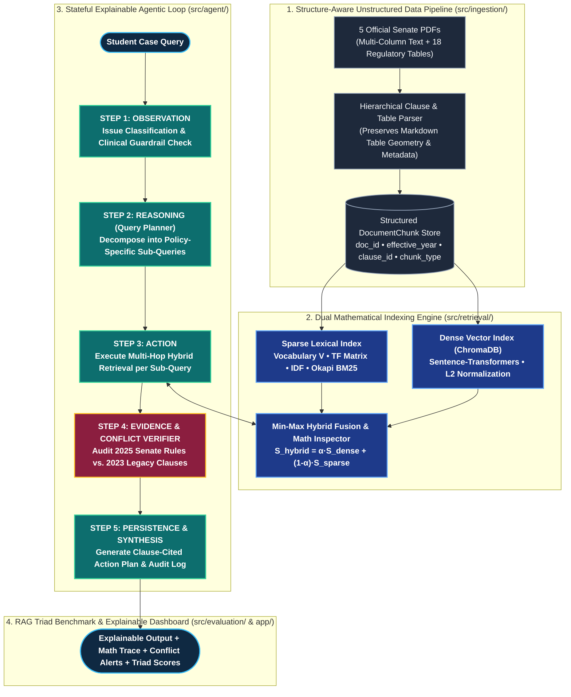
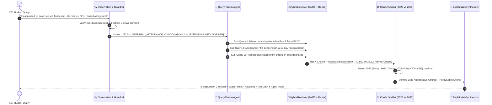
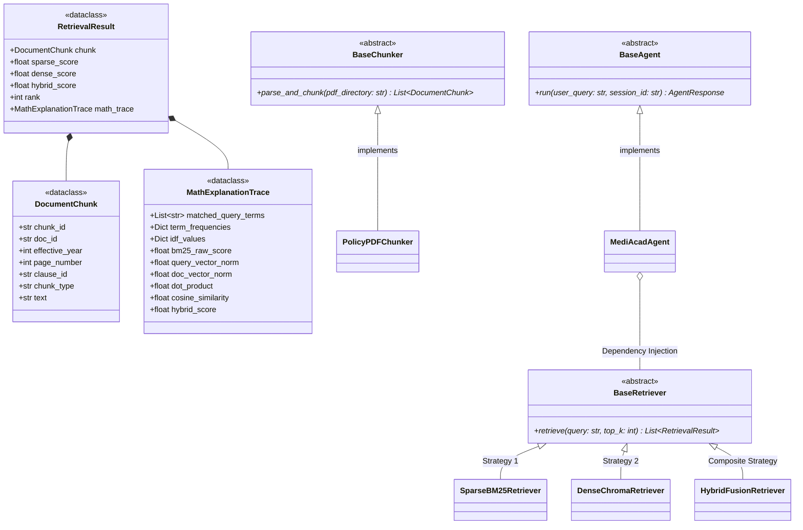

<div align="center">

# 🧠 MediAcad: Explainable Agentic RAG Engine
### Multi-Policy Information Retrieval, Mathematical Vector Mechanics & Automated Conflict Verification for Medical-Related Academic Case Guidance

<!-- LIVE ANIMATED TYPING SVG BANNER -->
<a href="https://github.com/adeeshachathurmina-ux/MediAcad-Agentic-RAG">
  
</a>

<br/>

[](https://github.com/adeeshachathurmina-ux/MediAcad-Agentic-RAG/actions)


-047857?style=for-the-badge)


[**1. Problem Formulation**](#-1-data-science-problem-formulation) •
[**2. System Architecture**](#-2-end-to-end-agentic-rag-architecture) •
[**3. OOP Class Design**](#-3-object-oriented-software-architecture-uml) •
[**4. Mathematical Foundations**](#-4-mathematical-foundations-of-information-retrieval) •
[**5. Policy Corpus & Conflicts**](#-5-unstructured-policy-corpus--conflict-matrix) •
[**6. Evaluation Benchmark**](#-6-rag-triad-evaluation-framework)

</div>

---

## 🔬 1. Data Science Problem Formulation

In university governance, resolving a student's medical emergency (such as a **10-day inpatient hospitalization**) is a **multi-hop, multi-document constraint satisfaction problem**. A single medical event simultaneously triggers rules across five distinct regulatory domains:

1. **Examination Deferral & Fit-to-Sit Compliance** (`POL-ACAD-EX-01` v4.0, 2025)
2. **Biometric Attendance Condonation & Hard Floors** (`POL-ACAD-AT-02` v3.2, 2025)
3. **Three-Tier Coursework Extensions & Late Penalty Schedules** (`POL-ACAD-CW-03` v3.0, 2025)
4. **SLMC Clinical Credentialing & UMC Verification** (`POL-MED-WF-04` v3.5, 2025)
5. **Annual Credit Progression & Legacy Rule Supersession** (`HBK-ACAD-PR-05` v1.8, 2023 vs. 2025 Overrides)

### Why Naive Single-Pass RAG Fails
Standard vector-only RAG systems fail on regulatory corpora due to three structural limitations:
* **Lexical Blindness on Exact Identifiers:** Dense embeddings often blur exact form codes (`Form EC-01` vs. `Form EXT-03C`) and clause numbers (`Clause 3.2`), requiring **Hybrid Sparse + Dense Fusion**.
* **Multi-Issue Under-Retrieval:** A single query embedding for *"10-day hospitalization affecting exams, attendance, and assignments"* gravitates toward one dominant document while missing secondary policy constraints.
* **Temporal Version Blindness:** Naive retrieval surfaces obsolete **2023 Student Handbook** clauses alongside **2025 Senate Revisions** without resolving which threshold legally governs.

> [!IMPORTANT]
> **Strict Administrative Scope Guardrail:** MediAcad models university regulatory logic exclusively. It enforces an input/output guardrail that refuses clinical diagnosis, symptom triage, or pharmacological advice.

---

## 🏗️ 2. End-to-End Agentic RAG Architecture

MediAcad replaces flat prompt pipelines with a stateful **Agentic Loop (`Observation ➔ Reasoning ➔ Action ➔ Verification ➔ Persistence`)** coupled with a **Dual-Index Hybrid Retrieval Engine**.



### 🔄 Real-Time Execution Sequence (10-Day Hospitalization Case)



---

## 🧩 3. Object-Oriented Software Architecture (UML)

To satisfy strict software engineering standards, the codebase enforces **Abstract Base Classes (`abc.ABC`)**, **Strongly-Typed Dataclasses**, **Strategy Pattern** (interchangeable Sparse, Dense, and Hybrid retrievers), and **Dependency Injection**:



---

## 📐 4. Mathematical Foundations of Information Retrieval

Unlike black-box wrappers, MediAcad explicitly computes, logs, and exposes the underlying linear algebra and probabilistic retrieval mechanics for every query-chunk pair $(Q, D)$.

### 4.1 Vocabulary Construction & Sparse Lexical Scoring (TF-IDF & Okapi BM25)
Given a corpus $\mathcal{C} = \{D_1, D_2, \dots, D_N\}$ of $N$ structure-aware policy chunks and vocabulary $\mathcal{V} = \{t_1, t_2, \dots, t_M\}$:

1. **Sublinear Term Frequency ($\text{TF}$):**
   $$\text{TF}(t, D) = \begin{cases} 1 + \ln f(t, D) & \text{if } f(t, D) > 0 \\ 0 & \text{otherwise} \end{cases}$$

2. **Smoothed Inverse Document Frequency ($\text{IDF}$):**
   $$\text{IDF}(t) = \ln\left(1 + \frac{N - \text{df}(t) + 0.5}{\text{df}(t) + 0.5}\right)$$

3. **Okapi BM25 Relevance Score ($k_1 = 1.5, \, b = 0.75$):**
   $$S_{\text{BM25}}(Q, D) = \sum_{t \in Q \cap D} \text{IDF}(t) \cdot \frac{f(t, D) \cdot (k_1 + 1)}{f(t, D) + k_1 \cdot \left(1 - b + b \cdot \frac{|D|}{\text{avgdl}}\right)}$$

---

### 4.2 Dense Vector Space Geometry ($L_2$ Magnitude, Dot Product & Cosine Similarity)
Each query $Q$ and chunk $D$ is mapped via an embedding encoder $\phi: \mathcal{T} \rightarrow \mathbb{R}^{d}$ into a $d$-dimensional real vector space ($\mathbf{q}, \mathbf{d} \in \mathbb{R}^{384}$):

1. **Euclidean Vector Magnitude ($L_2$ Norm):**
   $$\|\mathbf{q}\|_2 = \sqrt{\sum_{i=1}^{d} q_i^2}, \qquad \|\mathbf{d}\|_2 = \sqrt{\sum_{i=1}^{d} d_i^2}$$

2. **Inner (Dot) Product:**
   $$\mathbf{q} \cdot \mathbf{d} = \sum_{i=1}^{d} q_i \, d_i$$

3. **$L_2$ Unit Vector Normalization & Cosine Similarity:**
   $$\hat{\mathbf{q}} = \frac{\mathbf{q}}{\|\mathbf{q}\|_2}, \qquad \hat{\mathbf{d}} = \frac{\mathbf{d}}{\|\mathbf{d}\|_2}, \qquad S_{\text{cosine}}(\mathbf{q}, \mathbf{d}) = \cos(\theta) = \frac{\mathbf{q} \cdot \mathbf{d}}{\|\mathbf{q}\|_2 \, \|\mathbf{d}\|_2} = \hat{\mathbf{q}} \cdot \hat{\mathbf{d}} \in [-1, 1]$$

---

### 4.3 Min-Max Score Normalization & Convex Hybrid Fusion
Because $S_{\text{BM25}} \in [0, \infty)$ is unbounded whereas $S_{\text{cosine}} \in [-1, 1]$ is bounded, raw scores across candidate set $\mathcal{K}$ are normalized via Min-Max scaling prior to convex combination:

$$\tilde{S}_{\text{sparse}}(Q, D) = \frac{S_{\text{BM25}}(Q, D) - \min_{D' \in \mathcal{K}} S_{\text{BM25}}(Q, D')}{\max_{D' \in \mathcal{K}} S_{\text{BM25}}(Q, D') - \min_{D' \in \mathcal{K}} S_{\text{BM25}}(Q, D') + \epsilon}$$

$$S_{\text{hybrid}}(Q, D) = \alpha \cdot \tilde{S}_{\text{dense}}(Q, D) + (1 - \alpha) \cdot \tilde{S}_{\text{sparse}}(Q, D), \qquad \alpha \in [0, 1]$$

<details>
<summary><b>🔢 Click to Expand: Worked Numerical Math Trace Example (Exposed in MediAcad UI)</b></summary>
<br/>

For Query $Q =$ `"missed final exam 10-day hospitalization Form EC-01 deadline"` evaluated against Chunk `POL-ACAD-EX-01_p2_c3.2`:

```json
{
  "chunk_id": "POL-ACAD-EX-01_p2_c3.2",
  "matched_query_terms": ["missed", "examination", "hospitalization", "form", "ec-01", "5", "working", "days"],
  "term_frequencies": {"hospitalization": 2.0, "ec-01": 1.0, "working": 3.0, "days": 3.0},
  "idf_values": {"ec-01": 2.8904, "hospitalization": 1.7918, "working": 1.0986},
  "bm25_raw_score": 14.682,
  "bm25_normalized_score": 0.941,
  "query_vector_norm": 1.0000,
  "doc_vector_norm": 1.0000,
  "dot_product": 0.8842,
  "cosine_similarity": 0.8842,
  "alpha_weight": 0.50,
  "hybrid_score": 0.9126
}
```
</details>

---

## 📚 5. Unstructured Policy Corpus & Conflict Matrix

The repository includes **5 multi-page official university regulatory PDFs** (`data/raw_pdfs/`) engineered with multi-column glossaries, nested sub-clauses, and **18 structured regulatory tables**:

| Document ID | Official Policy Title | Edition & Status | Key Tables & Regulatory Mechanisms |
| :--- | :--- | :--- | :--- |
| **`POL-ACAD-EX-01`** | Examination & Medical Consideration Regulations | `v4.0 (2025 Senate Active)` | **4 Tables:** Fit-to-Sit doctrine, `Form INV-09` mid-exam collapse, 48h alert, **5-working-day** `Form EC-01` post-discharge rule, uncapped `I-Med` First-Sit. |
| **`POL-ACAD-AT-02`** | Attendance & Medical Absence Administration Policy | `v3.2 (2025 Senate Active)` | **4 Tables:** **80%** baseline, **70%–79%** HoD condonation (`Form ATT-02A`), **65%–69%** Dean's hospitalization waiver (`Form ATT-02B`), **<65%** `NQ` hard floor. |
| **`POL-ACAD-CW-03`** | Coursework, Continuous Assessment & Extension Policy | `v3.0 (2025 Senate Active)` | **3 Tables:** Tier-1 (**3d**), Tier-2 (**4–7d**), Tier-3 (**8–14d** `Form EXT-03C`), retrospective 3-day post-discharge rule, **5%/day** late penalty schedule (40% floor, Day-6 0%). |
| **`POL-MED-WF-04`** | Medical Documentation & Student Welfare Guidelines | `v3.5 (2025 Senate Active)` | **3 Tables:** SLMC credential matrix, mandatory UMC CMO Clearance Slip (`Form MED-04-CLR`), 10-day inpatient dossier checklist, Govt. Ayurvedic 3-day CMO rule. |
| **`HBK-ACAD-PR-05`** | Academic Progression Regulations & Student Handbook | `v1.8 (2023 Legacy Edition)` | **3 Tables:** Integrated 6-step hospitalization roadmap (`Form PRG-05-CASE`), 90/120 credit progression, 30-credit `I-Med` cap, **plus 5 legacy clauses superseded by 2025 policies**. |

### ⚡ Automated Temporal Policy Conflict Resolution Matrix (2025 vs. 2023)

| Conflict ID | Regulatory Parameter | Obsolete 2023 Handbook (`HBK-ACAD-PR-05` Sec 5) | Authoritative 2025 Senate Policy (Binding) | Superseding Citation |
| :--- | :--- | :--- | :--- | :--- |
| **`CONFLICT-01`** | Missed Exam Filing Window | `7 calendar days` from exam date | **`5 working days`** from exam or hospital discharge | `POL-ACAD-EX-01` v4.0, Clause 3.2 |
| **`CONFLICT-02`** | Minimum Attendance Floor | `60%` minimum with medical certificate | **`70%`** Standard / **`65%`** Inpatient Hard Floor (`<65%` Barred) | `POL-ACAD-AT-02` v3.2, Clauses 2.2 & 3.2 |
| **`CONFLICT-03`** | Unapproved Late CW Penalty | `2% per day` up to 10 calendar days | **`5% per working day`** up to 5 days (`0%` after Day 5) | `POL-ACAD-CW-03` v3.0, Clauses 4.1 & 4.2 |
| **`CONFLICT-04`** | Coursework Extension Limit | `Up to 21 days` granted by Module Lecturer | **`3 days`** Lecturer / **`7 days`** HoD / **`14 days max`** EC Panel | `POL-ACAD-CW-03` v3.0, Clauses 2.1–2.3 |
| **`CONFLICT-05`** | Ayurvedic Medical Notes | Private Ayurvedic notes accepted directly | **ONLY Govt. Ayurvedic Hospital + CMO stamp within `3 working days`** | `POL-MED-WF-04` v3.5, Clause 2.2 |

---

## 📊 6. RAG Triad Evaluation Framework

The system is quantitatively benchmarked (`src/evaluation/`) against **`data/evaluation/ground_truth.json` (32 curated test cases)** across 5 evaluation strata (*Single-Policy Clauses*, *Complex Table Lookups*, *Multi-Document Hospitalization Cases*, *2023 vs. 2025 Policy Conflicts*, and *Out-of-Scope Clinical Guardrails*):

$$\text{Context Relevance } (M_{\text{CR}}) = \frac{|\text{Retrieved Docs/Clauses} \cap \text{Ground-Truth Target Clauses}|}{|\text{Ground-Truth Target Clauses}|}$$

$$\text{Groundedness / Faithfulness } (M_{\text{GF}}) = \frac{\text{Number of Verified Claims / Form Codes Supported by Retrieved Context}}{\text{Total Factual Claims & Citations in Generated Answer}}$$

$$\text{Answer Relevance } (M_{\text{AR}}) = \beta \cdot \text{Cosine}(\mathbf{e}_{\text{ans}}, \mathbf{e}_{\text{ref}}) + (1 - \beta) \cdot \frac{|\text{Matched Expected Keywords}|}{|\text{Expected Keywords}|}$$

---

## 👥 7. Modular Package Ownership & Parallel Git Governance

```text
MediAcad-Agentic-RAG/
├── .github/workflows/ci.yml       # Automated GitHub Actions Pytest & Bytecode CI Pipeline
├── data/
│   ├── raw_pdfs/                  # 5 Official Multi-Page University Senate Policy PDFs
│   ├── fixtures/                  # Shared sample_chunks.json for zero-blocking parallel dev
│   ├── processed/                 # Structure-aware chunks generated by Member 1
│   └── evaluation/                # 32-case Ground-Truth Q&A benchmark dataset (Member 4)
├── src/
│   ├── interfaces/contracts.py    # Abstract Base Classes (ABC) & Shared Dataclasses
│   ├── ingestion/                 # [Member 1] PDF Table/Clause Parser & Hierarchical Chunker
│   ├── retrieval/                 # [Member 2] TF-IDF, BM25, Dense Embeddings & Math Inspector
│   ├── agent/                     # [Member 3] Agentic RAG Workflow & Policy Conflict Verifier
│   └── evaluation/                # [Member 4] Context Relevance, Faithfulness & Answer Relevance
├── app/streamlit_app.py           # [Member 4] Interactive Explainable Agentic RAG Dashboard
├── tests/test_smoke.py            # Automated CI/CD Smoke & Contract Verification Suite
└── requirements.txt               # Pinned Python 3.10+ dependencies
```

| Engineer Role | Dedicated Git Branch | Package Scope & Core Technical Deliverables |
| :--- | :--- | :--- |
| **Member 1** | `member1-ingestion` | `src/ingestion/` — PyMuPDF/pdfplumber table-preserving extraction, hierarchical clause regex chunker, metadata enrichment. |
| **Member 2** | `member2-retrieval` | `src/retrieval/` — Custom vocabulary/TF-IDF/BM25 sparse engine, ChromaDB dense store, $L_2$ norm/dot-product/cosine math trace. |
| **Member 3** | `member3-agent` | `src/agent/` — Stateful `Observation ➔ Reasoning ➔ Action ➔ Persistence` loop, sub-query planner, 2023 vs. 2025 conflict detector. |
| **Member 4 (Lead)** | `member4-eval-ui` | `src/evaluation/`, `app/` — 32-case ground-truth benchmark, automated RAG Triad evaluator, Streamlit XAI dashboard, CI/CD. |

---

## 🚀 8. Reproducible Setup & Execution

```bash
# 1. Clone the repository
git clone https://github.com/adeeshachathurmina-ux/MediAcad-Agentic-RAG.git
cd MediAcad-Agentic-RAG

# 2. Create and activate an isolated virtual environment
python -m venv .venv
.venv\Scripts\activate      # Windows PowerShell
# source .venv/bin/activate # Linux / macOS

# 3. Install pinned dependencies
pip install -r requirements.txt

# 4. Configure environment variables
cp .env.example .env

# 5. Execute automated unit & contract test suite
pytest tests/ -v

# 6. Launch the Explainable Agentic RAG Dashboard
streamlit run app/streamlit_app.py
```

---

<div align="center">
  <b>DS205.3 – Data Science with Python</b> • Faculty of Computing • NSBM Green University
</div>