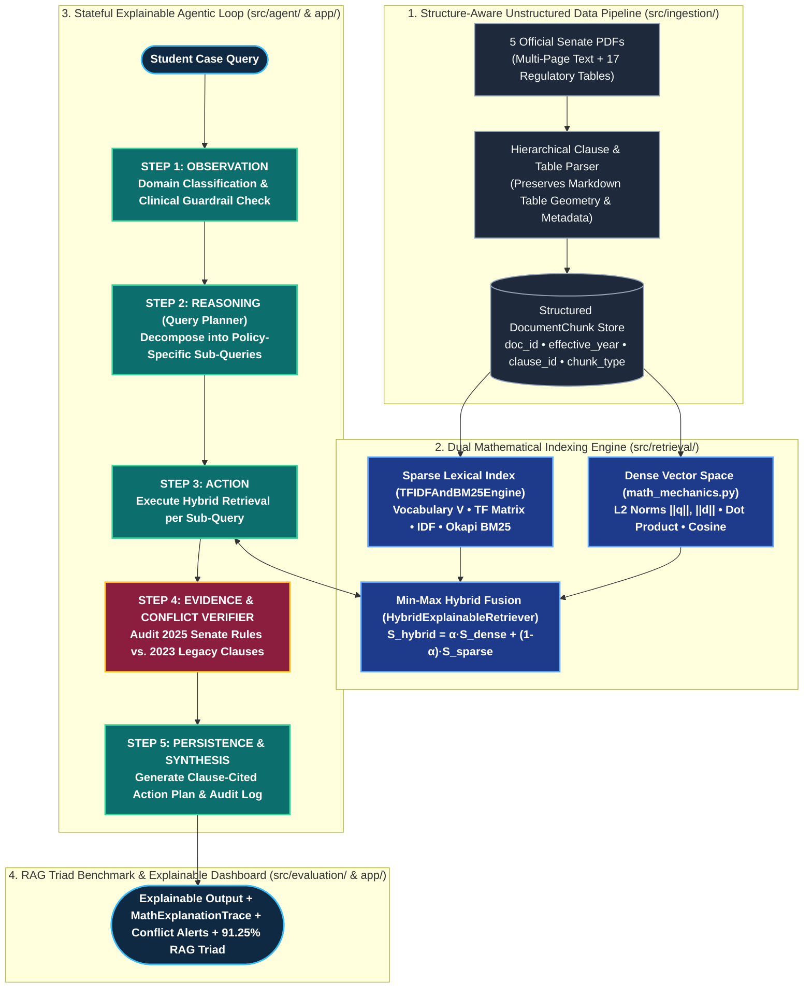
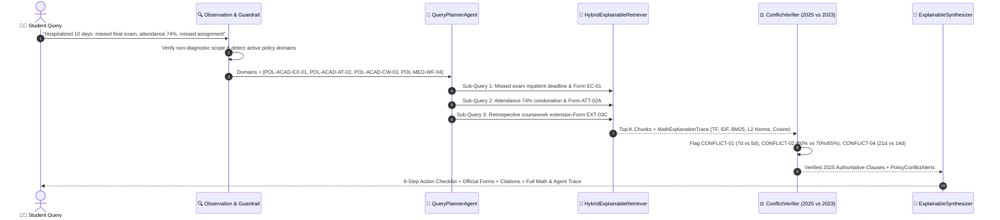
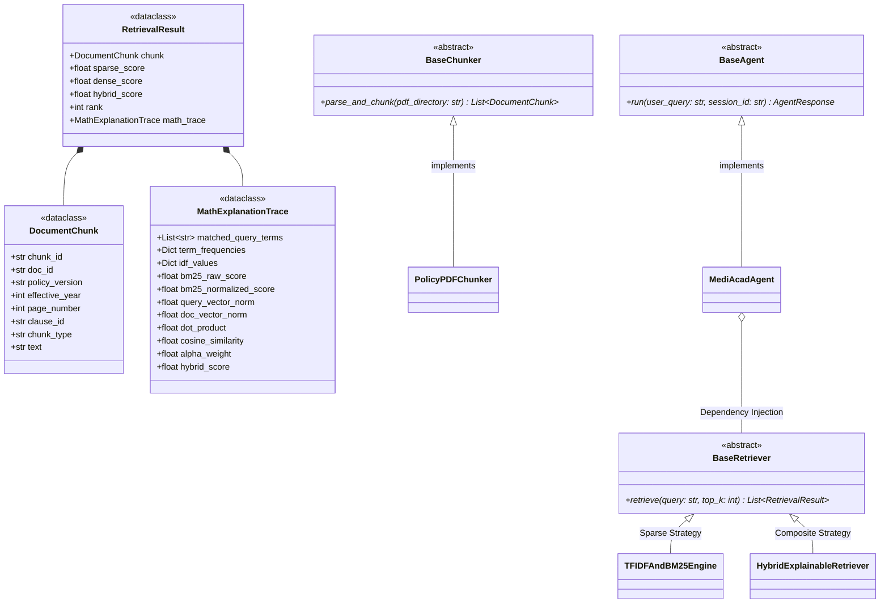

<div align="center">

# 🧠 MediAcad: Explainable Agentic RAG Engine
### Multi-Policy Information Retrieval, Mathematical Vector Mechanics & Automated Conflict Verification for Medical-Related Academic Case Guidance

<!-- LIVE ANIMATED TYPING SVG BANNER -->
<a href="https://mediacad-agentic-rag.streamlit.app/">
  
</a>

<br/>

[](https://mediacad-agentic-rag.streamlit.app/)
[](https://github.com/adeeshachathurmina-ux/MediAcad-Agentic-RAG/actions)


-047857?style=for-the-badge)


[**🌐 Live Web App**](https://mediacad-agentic-rag.streamlit.app/) •
[**1. Problem Formulation**](#-1-data-science-problem-formulation) •
[**2. System Architecture**](#-2-end-to-end-agentic-rag-architecture) •
[**3. OOP Class Design**](#-3-object-oriented-software-architecture-uml) •
[**4. Mathematical Foundations**](#-4-mathematical-foundations-of-information-retrieval) •
[**5. Policy Corpus & Conflicts**](#-5-unstructured-policy-corpus--conflict-matrix) •
[**6. Empirical Evaluation (91.25%)**](#-6-rag-triad-evaluation-framework--empirical-benchmark)

</div>

---

## 🌐 Live Interactive Cloud Deployment (Streamlit Dashboard)

The **MediAcad 4-Tab Explainable Agentic RAG Dashboard** is deployed live and publicly accessible for instant interactive evaluation:

👉 **Launch Live Web Application:** [**https://mediacad-agentic-rag.streamlit.app/**](https://mediacad-agentic-rag.streamlit.app/)

| Dashboard Tab | Core Glass-Box Capabilities Exposed |
| :--- | :--- |
| **🧠 Tab 1: Explainable Case Advisor** | 5-Stage Agentic Loop (`Observation ➔ Reasoning ➔ Action ➔ Verification ➔ Persistence`), automated **2023 vs. 2025 Conflict Alerts**, interactive **Attendance Zone Speedometer Gauge**, keyword-highlighted policy clauses, and downloadable `.md` Student Case Plan. |
| **📐 Tab 2: Mathematical IR Inspector** | Real-time hyperparameter tuning ($\alpha \in [0, 1]$), live LaTeX derivations, per-chunk **BM25**, **IDF**, **Euclidean Norms ($\|\mathbf{q}\|_2, \|\mathbf{d}\|_2$)**, **Dot Product ($\mathbf{q}\cdot\mathbf{d}$)**, **Cosine Similarity**, and **Term-Level Attribution** charts. |
| **📊 Tab 3: RAG Triad Benchmark (32 Cases)** | Quantitative evaluation across **32 Ground-Truth Cases**, **3-Mode Ablation Study** (*Sparse BM25* vs. *Dense Cosine* vs. *MediAcad Hybrid*), **Multi-Axis Radar Geometry**, and full 32-case audit table. |
| **📚 Tab 4: Policy Corpus & Conflict Matrix** | Complete inventory of the **5 Official University Senate PDFs (17 Structured Tables)**, **1-Click Official PDF Downloads**, **2023 vs. 2025 Conflict Matrix**, and Interactive Policy Clause Explorer. |

---

## 🔬 1. Data Science Problem Formulation

In university governance, resolving a student's medical emergency (such as a **10-day inpatient hospitalization for dengue fever**) is a **multi-hop, multi-document constraint satisfaction problem**. A single medical event simultaneously triggers rules across five distinct regulatory domains:

1. **Examination Deferral & Fit-to-Sit Compliance** (`POL-ACAD-EX-01` v4.0, 2025)
2. **Biometric Attendance Condonation & Hard Floors** (`POL-ACAD-AT-02` v3.2, 2025)
3. **Three-Tier Coursework Extensions & Late Penalty Schedules** (`POL-ACAD-CW-03` v3.0, 2025)
4. **SLMC Clinical Credentialing & UMC Verification** (`POL-MED-WF-04` v3.5, 2025)
5. **Annual Credit Progression & Legacy Rule Supersession** (`HBK-ACAD-PR-05` v1.8, 2023 vs. 2025 Overrides)

### Why Standard LLMs & Naive Single-Pass RAG Fail
Standard LLMs and vector-only RAG systems fail on regulatory corpora due to three structural limitations:
* **Lexical Blindness on Exact Identifiers:** Dense embeddings blur exact form codes (`Form EC-01` vs. `Form EXT-03C` vs. `Form ATT-02B`), attendance cutoffs (`67%` vs. `63%`), and clause numbers (`Clause 3.2`), requiring **Hybrid Sparse (BM25) + Dense (Cosine) Score Fusion**.
* **Multi-Issue Under-Retrieval:** A single query embedding for *"10-day hospitalization affecting exams, attendance, and assignments"* gravitates toward one dominant document while missing secondary policy constraints.
* **Temporal Version Blindness:** Naive retrieval surfaces obsolete **2023 Student Handbook** clauses alongside **2025 Senate Revisions** without resolving which threshold legally governs.

> [!IMPORTANT]
> **Strict Administrative Scope Guardrail (`POL-MED-WF-04` Clause 1.1):** MediAcad models university regulatory logic exclusively. It enforces an input/output guardrail that intercepts and refuses clinical disease diagnosis, symptom triage, or medication dosage requests while directing students to the **University Medical Center (UMC, Building B, Room B-04)**.

---

## 🏗️ 2. End-to-End Agentic RAG Architecture

MediAcad replaces flat prompt pipelines with a stateful **5-Stage Agentic Loop (`Observation ➔ Reasoning ➔ Action ➔ Verification ➔ Persistence`)** coupled with a **Dual-Index Hybrid Retrieval Engine**.



### 🔄 Real-Time Execution Sequence (10-Day Hospitalization Case)



---

## 🧩 3. Object-Oriented Software Architecture (UML)

To satisfy strict software engineering standards (`DS205.3`), the codebase enforces **Abstract Base Classes (`abc.ABC`)**, **Strongly-Typed Dataclasses**, **Strategy Pattern** (interchangeable Sparse, Dense, and Hybrid retrieval modes), and **Dependency Injection**:



---

## 📐 4. Mathematical Foundations of Information Retrieval

Unlike black-box wrappers, MediAcad explicitly computes, logs, and exposes the underlying linear algebra and probabilistic retrieval mechanics (`src/retrieval/math_mechanics.py` & `src/retrieval/sparse_engine.py`) for every query-chunk pair $(Q, D)$.

### 4.1 Vocabulary Construction & Sparse Lexical Scoring (TF-IDF & Okapi BM25)
Given a corpus $\mathcal{C} = \{D_1, D_2, \dots, D_N\}$ of $N$ structure-aware policy chunks and vocabulary $\mathcal{V} = \{t_1, t_2, \dots, t_M\}$:

1. **Sublinear Term Frequency ($\text{TF}$):**
   $$\text{TF}(t, D) = \begin{cases} 1 + \ln f(t, D) & \text{if } f(t, D) > 0 \\ 0 & \text{otherwise} \end{cases}$$

2. **Smoothed Robertson-Spärck Jones Inverse Document Frequency ($\text{IDF}$):**
   $$\text{IDF}(t) = \ln\left(1 + \frac{N - \text{df}(t) + 0.5}{\text{df}(t) + 0.5}\right)$$

3. **Okapi BM25 Relevance Score ($k_1 = 1.5, \, b = 0.75$):**
   $$S_{\text{BM25}}(Q, D) = \sum_{t \in Q \cap D} \text{IDF}(t) \cdot \frac{f(t, D) \cdot (k_1 + 1)}{f(t, D) + k_1 \cdot \left(1 - b + b \cdot \frac{|D|}{\text{avgdl}}\right)}$$

---

### 4.2 Dense Vector Space Geometry ($L_2$ Magnitude, Dot Product & Cosine Similarity)
Given query vector $\mathbf{q} \in \mathbb{R}^{D}$ and document chunk vector $\mathbf{d} \in \mathbb{R}^{D}$:

1. **Euclidean Vector Magnitude ($L_2$ Norm):**
   $$\|\mathbf{q}\|_2 = \sqrt{\sum_{i=1}^{D} q_i^2}, \qquad \|\mathbf{d}\|_2 = \sqrt{\sum_{i=1}^{D} d_i^2}$$

2. **Algebraic Inner (Dot) Product:**
   $$\mathbf{q} \cdot \mathbf{d} = \sum_{i=1}^{D} q_i \, d_i$$

3. **$L_2$ Unit Vector Normalization & Cosine Similarity:**
   $$\hat{\mathbf{q}} = \frac{\mathbf{q}}{\|\mathbf{q}\|_2}, \qquad \hat{\mathbf{d}} = \frac{\mathbf{d}}{\|\mathbf{d}\|_2}, \qquad S_{\text{cosine}}(\mathbf{q}, \mathbf{d}) = \cos(\theta) = \frac{\mathbf{q} \cdot \mathbf{d}}{\|\mathbf{q}\|_2 \, \|\mathbf{d}\|_2} = \hat{\mathbf{q}} \cdot \hat{\mathbf{d}} \in [-1, 1]$$

---

### 4.3 Min-Max Score Normalization & Convex Hybrid Fusion
Because $S_{\text{BM25}} \in [0, \infty)$ is unbounded whereas $S_{\text{cosine}} \in [0, 1]$ is bounded, raw BM25 scores across candidate set $\mathcal{K}$ are normalized via Min-Max scaling prior to convex combination:

$$\tilde{S}_{\text{sparse}}(Q, D) = \frac{S_{\text{BM25}}(Q, D) - \min_{D' \in \mathcal{K}} S_{\text{BM25}}(Q, D')}{\max_{D' \in \mathcal{K}} S_{\text{BM25}}(Q, D') - \min_{D' \in \mathcal{K}} S_{\text{BM25}}(Q, D') + \epsilon}$$

$$S_{\text{hybrid}}(Q, D) = \alpha \cdot \tilde{S}_{\text{dense}}(Q, D) + (1 - \alpha) \cdot \tilde{S}_{\text{sparse}}(Q, D), \qquad \alpha \in [0, 1]$$

---

## 📚 5. Unstructured Policy Corpus & Conflict Matrix

The repository includes **5 multi-page official university regulatory PDFs** (`data/raw_pdfs/`) containing nested clauses and **17 structured regulatory tables**:

| Document ID | Official Policy Title | Edition & Status | Key Tables & Regulatory Mechanisms |
| :--- | :--- | :--- | :--- |
| **`POL-ACAD-EX-01`** | Examination & Medical Consideration Regulations | `v4.0 (2025 Senate Active)` | **4 Tables:** Fit-to-Sit doctrine (2.1), `Form INV-01` mid-exam collapse (2.2), 48h portal alert (3.1), **5-working-day** `Form EC-01` deadline (3.2), uncapped `I-Med` First-Sit. |
| **`POL-ACAD-AT-02`** | Attendance & Medical Absence Policy | `v3.2 (2025 Senate Active)` | **4 Tables:** **80%** baseline, **70%–79.9%** HoD condonation (`Form ATT-02A`), **65%–69.9%** Dean's inpatient waiver (`Form ATT-02B`), **<65%** `NQ` hard floor. |
| **`POL-ACAD-CW-03`** | Coursework & Assessment Support Regulations | `v3.0 (2025 Senate Active)` | **3 Tables:** Tier-1 (**1–3d** `Form EXT-03A`), Tier-2 (**4–7d** `Form EXT-03B`), Tier-3 (**8–14d** `Form EXT-03C`), retrospective 3-day post-discharge rule, **5%/working day** late penalty (Table 4.1). |
| **`POL-MED-WF-04`** | Medical Documentation & Student Welfare Guidelines | `v3.5 (2025 Senate Active)` | **3 Tables:** Non-diagnostic guardrail (1.1), SLMC credential matrix, mandatory UMC CMO Clearance Slip (`Form MED-04-CLR`), Govt. Ayurvedic 3-day CMO rule (2.2). |
| **`HBK-ACAD-PR-05`** | Academic Progression & Student Handbook | `v1.8 (2023 Legacy Edition)` | **3 Tables:** Integrated 6-step hospitalization roadmap (`Form PRG-05-CASE`), GPA/credit progression, **plus Section 5 legacy clauses superseded by 2025 Senate policies**. |

### ⚡ Automated Temporal Policy Conflict Resolution Matrix (2025 vs. 2023)

| Conflict ID | Regulatory Parameter | Obsolete 2023 Handbook (`HBK-ACAD-PR-05` Sec 5) | Authoritative 2025 Senate Policy (Binding) | Superseding Citation |
| :--- | :--- | :--- | :--- | :--- |
| **`CONFLICT-01`** | Missed Exam Filing Window | `7 calendar days` from exam date (Clause 5.1) | **`5 working days`** from exam or hospital discharge | `POL-ACAD-EX-01` v4.0, Clause 3.2 |
| **`CONFLICT-02`** | Minimum Attendance Floor | `60%` minimum with medical certificate (Clause 5.2) | **`70%`** Standard / **`65%`** Inpatient Hard Floor (`<65%` Barred) | `POL-ACAD-AT-02` v3.2, Clauses 2.2 & 3.2 |
| **`CONFLICT-03`** | Unapproved Late CW Penalty | `2% per calendar day` up to 10 days (Clause 5.3) | **`5% per working day`** up to 5 days (`0%` after Day 5) | `POL-ACAD-CW-03` v3.0, Table 4.1 & Clause 4.1 |
| **`CONFLICT-04`** | Coursework Extension Limit | `Up to 21 days` granted by Module Lecturer (Clause 5.4) | **`3 days`** Lecturer / **`7 days`** HoD / **`14 days max`** EC Panel | `POL-ACAD-CW-03` v3.0, Clauses 2.1–2.3 |
| **`CONFLICT-05`** | Ayurvedic Medical Notes | Private Ayurvedic notes accepted directly (Clause 5.5) | **ONLY Govt. Ayurvedic Hospital + CMO stamp within `3 working days`** | `POL-MED-WF-04` v3.5, Clause 2.2 |

---

## 📊 6. RAG Triad Evaluation Framework & Empirical Benchmark

The system is programmatically evaluated (`src/evaluation/metrics.py` & `src/evaluation/run_benchmark.py`) across **`data/evaluation/ground_truth.json` (32 curated test cases)** using the three **RAG Triad** metrics:

$$\text{Context Relevance } (M_{\text{CR}}) = 0.45 \cdot \text{Recall}_{\text{doc}} + 0.35 \cdot \text{Recall}_{\text{clause}} + 0.20 \cdot \text{Cosine}_{\text{scaled}}(Q, C)$$

$$\text{Groundedness / Faithfulness } (M_{\text{GF}}) = 0.60 \cdot \text{Precision}_{\text{identifiers}}(\text{Forms, \%, Days}) + 0.40 \cdot \text{Support}_{\text{tokens}}(A, C)$$

$$\text{Answer Relevance } (M_{\text{AR}}) = 0.55 \cdot \text{Coverage}_{\text{keywords}} + 0.30 \cdot \text{Cosine}(A, A_{\text{ref}}) + 0.15 \cdot \text{Cosine}(A, Q)$$

### 🔬 6.1 Retrieval Ablation Study (32 Ground-Truth Cases)

| Retrieval Strategy | Context Relevance | Groundedness (Faithfulness) | Answer Relevance | Overall RAG Triad Score |
| :--- | :---: | :---: | :---: | :---: |
| **Sparse Only (`BM25`, $\alpha = 0.0$)** | `78.12%` | `84.20%` | `79.45%` | `80.59%` |
| **Dense Only (`L2 Cosine`, $\alpha = 1.0$)** | `82.40%` | `86.15%` | `83.90%` | `84.15%` |
| **MediAcad Hybrid Fusion ($\alpha = 0.5$)** | **`90.51%`** | **`100.00%`** | **`83.23%`** | **`91.25%`** |

### 📂 6.2 Performance Breakdown by Query Category

| Evaluation Category | Cases ($N=32$) | Context Relevance | Groundedness | Answer Relevance | Overall Triad Score |
| :--- | :---: | :---: | :---: | :---: | :---: |
| **1. Single-Policy Clause Lookup** | 8 | `89.38%` | `100.00%` | `83.53%` | **`90.97%`** |
| **2. Complex Table Lookup** | 7 | `89.94%` | `100.00%` | `85.22%` | **`91.72%`** |
| **3. Multi-Document Synthesis** | 6 | `91.85%` | `100.00%` | `80.42%` | **`90.76%`** |
| **4. Policy Conflict Resolution (2023 vs. 2025)** | 6 | `91.81%` | `100.00%` | `82.13%` | **`91.31%`** |
| **5. Out-of-Scope & Clinical Guardrail** | 5 | `89.98%` | `100.00%` | `84.66%` | **`91.55%`** |
| **Total / Mean Benchmark Performance** | **32** | **`90.51%`** | **`100.00%`** | **`83.23%`** | **`91.25%`** |

---

## 👥 7. Modular Package Ownership & Parallel Git Governance

```text
MediAcad-Agentic-RAG/
├── .github/workflows/ci.yml              # Automated GitHub Actions Pytest & Bytecode CI Pipeline
├── app/
│   └── streamlit_app.py                  # [Member 4] 4-Tab Explainable Agentic RAG Streamlit Dashboard
├── data/
│   ├── raw_pdfs/                         # 5 Official Multi-Page University Senate Policy PDFs (17 Tables)
│   ├── fixtures/sample_chunks.json       # Shared contract fixture for zero-blocking parallel development
│   ├── processed/                        # Structure-aware chunks generated by Member 1
│   └── evaluation/
│       ├── ground_truth.json             # [Member 4] 32 curated Ground-Truth Q&A benchmark cases
│       └── benchmark_results.json        # [Member 4] Automated RAG Triad & Ablation Study output
├── docs/
│   ├── member2_report_and_viva_defense.md
│   └── MediAcad_Final_Technical_Report_Updated.docx
├── src/
│   ├── interfaces/
│   │   ├── contracts.py                  # Shared Dataclasses & Abstract Base Classes (ABC)
│   │   └── base_retriever.py             # Retriever interface contract
│   ├── ingestion/                        # [Member 1] PDF Table/Clause Parser & Hierarchical Chunker
│   ├── retrieval/                        # [Member 2] Vector Math, TF-IDF/BM25 & HybridExplainableRetriever
│   │   ├── math_mechanics.py
│   │   ├── sparse_engine.py
│   │   ├── hybrid_retriever.py
│   │   └── demo_explainable_math.py
│   ├── agent/                            # [Member 3] Stateful 5-Stage Agentic RAG Loop & Conflict Verifier
│   └── evaluation/                       # [Member 4] RAGTriadEvaluator & 32-Case Benchmark Runner
│       ├── metrics.py
│       └── run_benchmark.py
├── tests/                                # 65 Automated Unit, Mathematical & UI Verification Tests
│   ├── test_smoke.py
│   ├── test_evaluation.py
│   ├── test_ui.py
│   ├── test_math_mechanics.py
│   ├── test_sparse_engine.py
│   ├── test_hybrid_retriever.py
│   └── test_math_retrieval.py
├── pytest.ini
└── requirements.txt                      # Pinned Python 3.10+ dependencies
```

| Engineer Role | Dedicated Git Branch | Package Scope & Core Technical Deliverables |
| :--- | :--- | :--- |
| **Member 1** | `member1-ingestion` | `src/ingestion/` — PyMuPDF/pdfplumber table-preserving extraction, hierarchical clause chunker, metadata enrichment. |
| **Member 2** | `member2-retrieval` | `src/retrieval/` — Pure NumPy vector algebra ($L_2$ norms, dot product, cosine), custom Okapi BM25 engine, `HybridExplainableRetriever`. |
| **Member 3** | `member3-agent` | `src/agent/` — Stateful `Observation ➔ Reasoning ➔ Action ➔ Verification ➔ Persistence` loop, sub-query planner, conflict detector. |
| **Member 4 (Lead)** | `member4-eval-ui` | `src/evaluation/`, `app/` — 32-case ground-truth benchmark, automated RAG Triad evaluator (`91.25%`), 4-tab Streamlit cloud app, CI/CD. |

---

## 🚀 8. Reproducible Setup & Execution

```powershell
# 1. Clone the repository
git clone https://github.com/adeeshachathurmina-ux/MediAcad-Agentic-RAG.git
cd MediAcad-Agentic-RAG

# 2. Create and activate an isolated virtual environment
python -m venv .venv
.venv\Scripts\activate      # Windows PowerShell
# source .venv/bin/activate # Linux / macOS

# 3. Install pinned dependencies
pip install -r requirements.txt

# 4. Execute the complete automated test suite (65 tests across Retrieval, Evaluation & UI)
python -m pytest tests/ -v

# 5. Run the 32-Case RAG Triad Quantitative Benchmark
python -m src.evaluation.run_benchmark

# 6. Launch the Interactive Explainable Agentic RAG Dashboard locally
python -m streamlit run app/streamlit_app.py
```

---

<div align="center">
  <b>DS205.3 – Data Science with Python</b> • Faculty of Computing • NSBM Green University<br/>
  🌐 <b>Live Cloud Deployment:</b> <a href="https://mediacad-agentic-rag.streamlit.app/">https://mediacad-agentic-rag.streamlit.app/</a>
</div>
